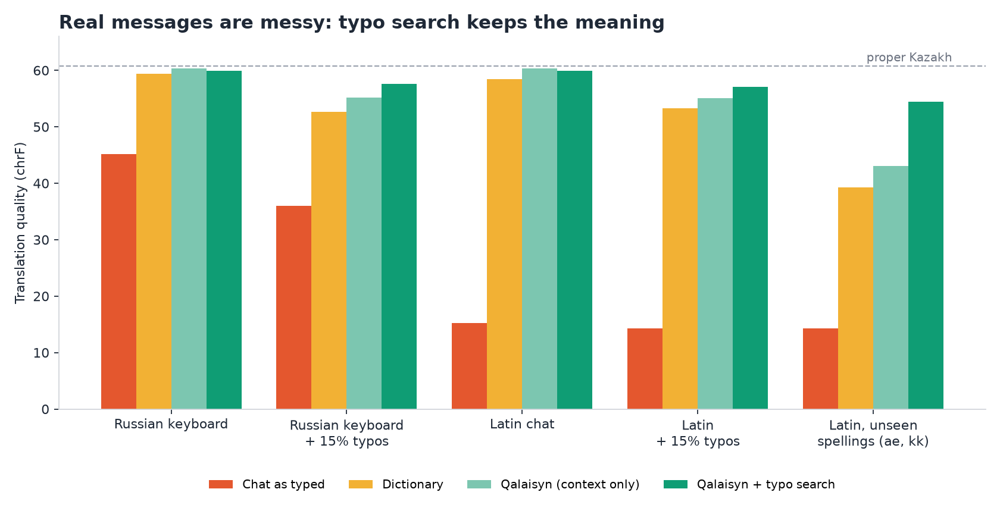

# Qalaisyn — making AI understand Kazakh the way people actually text

**Veritas AI International High School Hackathon 2026 · Track: Languages**

> AI understands Kazakh only when it is written "properly" — and almost nobody texts that way.

Most phones in Kazakhstan have a Russian keyboard, so people type *калайсын* instead of *қалайсың* (others type
*qalaisyn* in Latin). **Qalaisyn** is a layer that sits inside any chatbot, translator or keyboard, like autocorrect,
and restores standard Kazakh; when unsure it shows suggestions instead of silently guessing.
On held-out data it fixes Russian-keyboard text (47% of words misspelled → 3.6%) and recovers 94% of the meaning a
translator loses (98% for Latin); on messy messages with typos it recovers 87% vs. 67% for a dictionary baseline.
Only 5% of words become suggestions, and they contain 59% of its mistakes. The same code recovers 97% for Kyrgyz.



* **Notebook with all results:** [`Qalaisyn.ipynb`](Qalaisyn.ipynb)
* **One-page write-up:** [`WRITEUP.md`](WRITEUP.md) / `WRITEUP.pdf`

## Repository
| Path | What it is |
|---|---|
| `src/chatify.py` | simulates four chat typing styles, typos and unseen spellings |
| `src/build_data.py` | builds training text and held-out test sets |
| `src/restore.py` | B1 rules, B2 dictionary, M1/M2 Qalaisyn (candidates + habit model + bigram LM + Viterbi + char 5-gram + typo search) |
| `src/build_cyr.py` | Russian-keyboard / partial-keyboard Cyrillic test sets |
| `src/eval_restore.py`, `src/stress.py` | word/char error rates, stress tests |
| `src/confidence.py` | per-word confidence (forward-backward), suggestions, calibration |
| `src/kyrgyz.py` | transfer test on Kyrgyz |
| `src/eval_translate.py` | NLLB-200 translation + chrF |
| `src/analysis.py`, `src/charts.py` | failure analysis and figures |
| `src/app.py` | Gradio demo |

## Reproduce
```bash
pip install numpy pandas scikit-learn sacrebleu matplotlib pyarrow torch transformers==4.46.3 sentencepiece gradio==5.9.1
# download raw data: see the setup cell in Qalaisyn.ipynb
python src/build_data.py && python src/build_cyr.py
for s in test_tatoeba test_flores test_tatoeba_cyr test_flores_cyr; do python src/eval_restore.py $s; done
python src/stress.py test_tatoeba && python src/stress.py test_flores
python src/eval_translate.py test_tatoeba test_flores test_tatoeba_cyr test_flores_cyr test_tatoeba_typos-5 test_tatoeba_typos-15 test_tatoeba_unseen-habits test_tatoeba_cyr-typos-15 test_flores_typos-15 test_flores_unseen-habits
python src/confidence.py && python src/kyrgyz.py
python src/analysis.py && python src/charts.py
python src/app.py --share
```

*Prototype. Not for medical, financial or emergency use.* Sources and licences: see `WRITEUP.md`.
